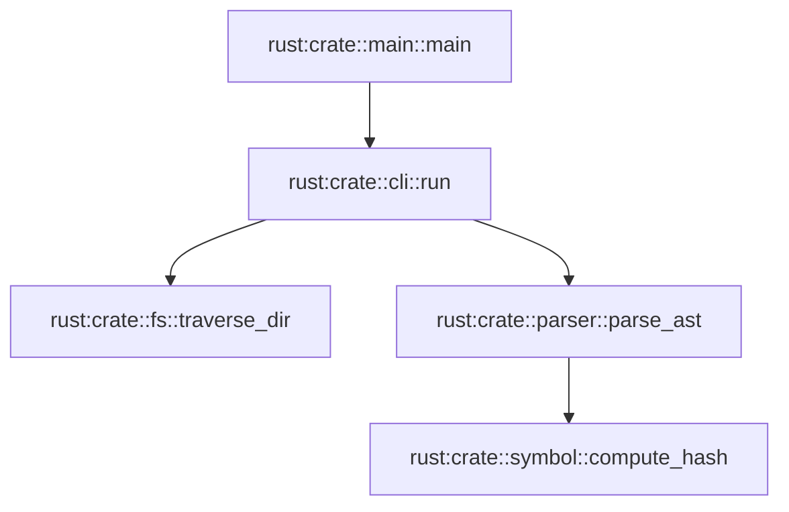

# Leña 🪵

> A friendly, graph-backed Swiss Army knife for understanding code, exploring call relationships, building clean documentation, and giving language models precise context.

Modern codebases are graphs, but we usually look at them through flat file trees. **Leña** parses multi-language codebases into an embedded graph database, connecting symbols, modules, files, and call relationships together so you can see how your project actually fits together.

Whether you want to generate documentation with interactive call graphs, export deterministic context windows for LLMs, or trace transitive callers across a project, Leña gives you the tools without heavyweight infrastructure.

---

## What Can Leña Do?

### 1. Ingest & Index Codebases into a Datalog Graph

Leña runs lightweight language adapters that extract AST symbols, locations, docstrings, and call sites, streaming them into an embedded [MesoDB](https://github.com/yeajustmars/mesodb) database. Everything is modeled as an open Universal Intermediate Representation (UIR) queryable with recursive Datalog rules (like `calls_transitive` and `parent_transitive`).

* **Current Adapters:** Rust (`lena-adapter-rust`), Clojure (`lena-adapter-clj`), Go (`lena-adapter-go`), and Tree-sitter for Python and JavaScript (`lena-adapter-treesitter`).

### 2. Beautiful, Modern Static Documentation (`lena doc`)

Turn your indexed codebase into clean, searchable static documentation with a single command:

* **`lena-book` Theme:** Multi-page documentation site with instant, offline client-side symbol search.
* **Call Neighborhood Graphs:** Every documented function or struct automatically generates an interactive [Mermaid.js](https://mermaid.js.org/) graph showing who calls it and what it calls.
* **Built-in Themes:** Support for Grayscale, Navy, Green, Poimandres, and Gruvbox, complete with light/dark auto-detection and a UI mode toggle.
* **Alternative Formats:** Also supports single-page standalone HTML exports and `mdbook` generation.

### 3. Precise LLM Context Windows (`lena prompt`)

Stop dumping thousands of tokens of irrelevant source code into chat windows. With `lena prompt`, target a specific Fully Qualified Symbol Name (FQSN) to extract a surgical prompt bundle containing:

* The symbol’s exact source location, signature, and docstrings.
* A resolved list of callers and callees pulled directly from the graph.
* Output formatted as clean XML or Markdown ready for LLM system prompts.

### 4. Deterministic Code Snapshots (`lena snapshot`)

When you *do* need full directory context for an LLM, standard markdown snippets often break when embedded files contain backticks. Leña walks your directories (respecting `.gitignore`, `target/`, and vendor directories) and bundles files safely into CDATA-wrapped XML or Markdown.

### 5. Call Graph Skeletons (`lena skeleton`)

Trace recursive call graphs from any symbol down to a bounded depth. Export the trace as:

* An indented ASCII tree for quick terminal inspection.
* A Mermaid diagram ready to paste into documentation.
* A Graphviz DOT graph for deep architectural analysis.

---

## Quickstart

### Installation

Install `lena` and the language adapters via `cargo`:

```bash
cargo install lena
cargo install lena-adapter-rust
cargo install lena-adapter-clj
cargo install lena-adapter-treesitter
```

### Building from Source

You can also build the entire workspace locally:

```bash
git clone [https://github.com/yourusername/lena.git](https://github.com/yourusername/lena.git)
cd lena
cargo build --release
```

The compiled binaries will be available in `target/release/`.

---

## Practical Examples

### 1. Indexing a Project

Run Leña against your project root to scan files and populate the local graph database (`.lena/db`):

```bash
lena index .
```

### 2. Generating Documentation (`lena doc`)

Generate the multi-page static documentation book:

```bash
# Generate the book into dist/ (default)
lena doc --theme lena-book --out dist/

# Or generate a single self-contained HTML file
lena doc --theme single-page --out dist/
```

Open `dist/index.html` in your browser to browse symbols, view neighborhood call charts, and toggle themes.

### 3. Exporting Context for an LLM Prompt

Target a specific function or struct and get its entire immediate call neighborhood formatted for an AI model:

```bash
# Export markdown context for a function
lena prompt rust:crate::exporter::export_prompt --format markdown

# Export structured XML
lena prompt rust:crate::exporter::export_prompt --format xml
```

Example Markdown output:

````markdown
### `export_prompt`

- **Language:** `Rust`
- **Location:** `lena-core/src/exporter.rs:188`

**Signature:**
```rust
pub async fn export_prompt(db: &Arc<LenaDb>, fqsn: &str, format: ExportFormat) -> Result<String, ExporterError>
```

**Called By:**
- `rust:crate::main::main`

**Makes Calls To:**
- `rust:crate::db::LenaDb::query_with_rules`
- `rust:crate::exporter::LenaContext::to_markdown`
- `rust:crate::exporter::LenaContext::to_xml`
````

### 4. Taking a Directory Snapshot

Pack an entire directory tree into a clean XML bundle to feed into an LLM:

```bash
lena snapshot lena-core/src --format xml --out core-snapshot.xml

```

### 5. Visualizing a Call Skeleton

Generate a bounded call graph starting from a root entry point:

**Indented Tree Format:**

```bash
lena skeleton "rust:crate::main::main" --depth 3 --format indented

```

```text
└── rust:crate::main::main
  └── rust:crate::cli::run
    └── rust:crate::fs::traverse_dir
    └── rust:crate::parser::parse_ast

```

**Mermaid Diagram Format:**

```bash
lena skeleton "rust:crate::main::main" --depth 5 --format mermaid

```



---

## Architecture at a Glance

```text
Source Files (.rs, .go, .clj, .py, .js, ...)
                     │
                     ▼
           [ Language Adapters ]
                     │ (Streams ND-EDN facts)
                     ▼
           [ MesoDB Graph Engine ]  ◄─── Evaluates recursive Datalog rules
                     │
            [ DocGraph / UIR ]
                     │
  ┌───────────┬──────┴────────┬────────────────┐
  ▼           ▼               ▼                ▼
lena doc   lena prompt   lena snapshot   lena skeleton
(HTML/CSS)  (LLM Context) (Dir Bundles)   (Graphviz/Mermaid)

```

1. **Adapters:** Standalone binaries parse ASTs and emit newline-delimited EDN transaction facts.


2. **Database Engine (`lena-core`):** MesoDB transacts facts into a unified graph schema tracking identities, parents, signatures, and call sites.


3. **Consumers:** Frontends and CLI tools query the graph to build views, search indexes, or prompt contexts.


---

## Contributing

Leña is open source and built to be approachable. If you would like to add a language adapter, tweak the documentation templates, or improve graph queries, pull requests and issues are very welcome!

1. Fork the repository
2. Create your feature branch (`git checkout -b feature/cool-idea`)
3. Commit your changes (`git commit -m 'Add cool idea'`)
4. Push to the branch (`git push origin feature/cool-idea`)
5. Open a Pull Request

